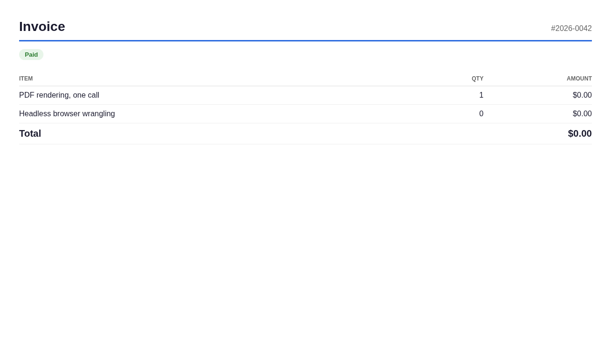

**You need a PDF from Go. You did not sign up to manage a headless browser.**

The current options all charge a tax: raw chromedp or go-rod means pages of
allocator flags and protocol calls, plus a Chrome you install and version
yourself. Gotenberg means running a second service. wkhtmltopdf is archived.

pagemill is one call:

```go
pdf, err := pagemill.HTML(invoiceHTML)
```

It downloads a pinned
[chrome-headless-shell](https://googlechromelabs.github.io/chrome-for-testing/)
build once, caches it, and renders your HTML with real browser layout:
flexbox, grid, web fonts, your CSS as-is. PNG screenshots too.

## Install

```sh
go get github.com/ofershap/pagemill@latest
```

## Use

```go
package main

import (
    "os"

    "github.com/ofershap/pagemill"
)

func main() {
    html := `<!DOCTYPE html><html><body><h1>Invoice #42</h1></body></html>`

    pdf, err := pagemill.HTML(html) // A4, 0.4in margins
    if err != nil {
        panic(err)
    }
    os.WriteFile("invoice.pdf", pdf, 0o644)

    png, err := pagemill.PNG(html) // 1280px-wide full-page capture
    if err != nil {
        panic(err)
    }
    os.WriteFile("invoice.png", png, 0o644)
}
```

With options:

```go
pdf, err := pagemill.HTML(html, func(o *pagemill.Options) {
    o.PaperWidth, o.PaperHeight = 8.5, 11 // Letter
    o.Landscape = true
    o.Margin = 0.25
    o.Timeout = time.Minute
})
```

Bring your own browser (containers, CI images):

```go
pdf, err := pagemill.HTML(html, func(o *pagemill.Options) {
    o.BrowserPath = "/usr/bin/google-chrome" // skips the download
})
```

## What it costs

pagemill trades disk and memory for not thinking about browsers. The numbers,
measured on a 2-vCPU Linux container, chrome-headless-shell 157.0.8103.78:

| Cost | Measured |
| ---- | -------- |
| One-time browser download | 128MB compressed, 277MB on disk |
| PDF render, cached browser | ~130-190ms per call |
| Memory per render | a full Chrome process; budget a few hundred MB |
| Dependencies | `chromedp` v0.23 (pinned; our API stays stable even if its API moves) |

Each call starts a fresh browser: calls are independent, nothing leaks
between them, and you pay browser startup per render. If you render thousands
of documents an hour, that model is the thing to measure first.

## What it is not

- Not a new PDF engine. It drives Chrome; it inherits Chrome's layout and
  Chrome's appetite. The RAM complaints about driving browsers yourself
  apply here too: pagemill removes the plumbing, not the browser.
- Not a template library. You write HTML and CSS; it renders them.
- Not a service. Everything runs in your process and your cache directory;
  the only network call is the one-time browser download from the official
  Chrome for Testing endpoint (and whatever your own HTML loads).

## Containers

Two container-safe flags are on by default and you should know they are:
`--no-sandbox` (Chrome's sandbox cannot initialize in most containers) and
`--disable-dev-shm-usage` (Docker's default `/dev/shm` is too small and
crashes Chrome under load). To bake the browser into your image instead of
downloading at runtime, install Chrome in the Dockerfile and set
`BrowserPath`.

<details>
<summary>Q&A</summary>

**How do I convert HTML to PDF in Go without wkhtmltopdf?**
wkhtmltopdf is archived. pagemill renders with a current Chrome:
`pagemill.HTML(html)` returns the PDF bytes.

**Does pagemill need Node, Python, or a running server?**
No. It is a Go library; the only external piece is the Chrome binary it
downloads once into your user cache.

**Can I use my own Chrome or Chromium?**
Yes: set `Options.BrowserPath`. The download is skipped entirely.

**How do I get a PNG screenshot of HTML in Go?**
`pagemill.PNG(html)` returns a 1280px-wide full-page PNG.

**Does it work in Docker and CI?**
Yes. Container-required Chrome flags are set by default, and the test suite
runs on GitHub's ubuntu, macOS, and Windows runners against their
preinstalled Chrome.

**Which Chrome version renders my document?**
By default, the current Stable chrome-headless-shell, resolved from the
official Chrome for Testing endpoint at first use. Pin one with
`Options.Version`.

</details>

## Status

v0.1.0. The API is `HTML`, `PNG`, and `Options`; that surface is the
compatibility promise. Rendering is covered by tests that run real Chrome on
Linux, macOS, and Windows CI runners.

---

## Author

[](https://gitshow.dev/ofershap)

[](https://linkedin.com/in/ofershap)
[](https://github.com/ofershap)
[](https://ofershap.github.io/)

---

<sub>README built with [README Builder](https://ofershap.github.io/readme-builder/)</sub>

## License

[MIT](LICENSE) &copy; [Ofer Shapira](https://github.com/ofershap)
